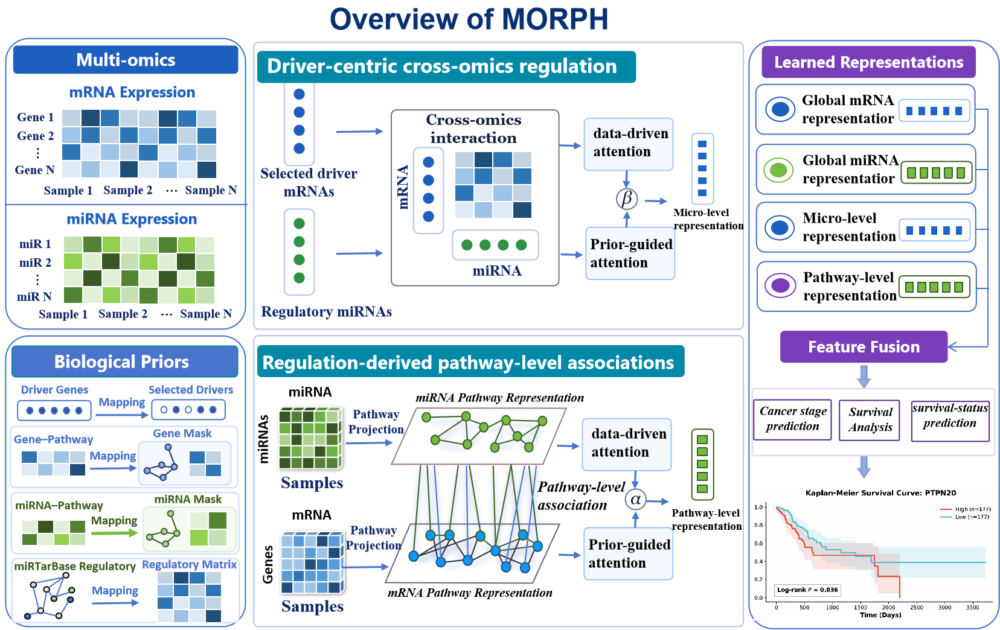

# MORPH

**MORPH: Integrating Multi-Scale Priors from Driver-Centric Targeted Regulation to Pathway Crosstalk for Interpretable Cancer Prognosis**

MORPH integrates mRNA and miRNA expression with driver-centric regulatory priors and pathway-level associations for cancer prognosis prediction.



## Code and datasets

- **Code:** https://github.com/zppaper/MORPH
- **Datasets:** https://zenodo.org/records/23299794
- **Dataset DOI:** https://doi.org/10.5281/zenodo.23299794
- **Download:** [datasets.rar](https://zenodo.org/records/23299794/files/datasets.rar)

## Directory setup

Download the code and extract `datasets.rar`. Arrange the code, processed datasets, and biological priors as follows for the main classification experiments:

```text
MORPH/
├── README.md
├── requirements.txt
├── assets/
├── datasets/
│   ├── stage/
│   │   ├── KIRC/
│   │   ├── MESO/
│   │   ├── STAD/
│   │   └── THCA/
│   ├── vital_status/
│   │   ├── LAML/
│   │   ├── SKCM/
│   │   └── UVM/
│   └── priors/
│       ├── 20230205_kegg_hsa.gmt
│       ├── kegg_anano.txt
│       └── miRTarBase_MTI_processed_cleaned.csv
└── MORPH/
    ├── run_stage.py
    ├── run_vital_status.py
    ├── configs/
    ├── morph/
    ├── resources/
    │   └── driver_genes_list.txt
    ├── MORPH_ablation/
    ├── MORPH_case_analysis/
    ├── MORPH_data_preparation/
    └── MORPH_survival_comparison/
```

Each cohort directory contains `mRNA.csv`, `miRNA.csv`, and `label.csv`. Place `datasets/` at the repository root, alongside the inner `MORPH/` code directory. Keep the driver-gene list in `MORPH/resources/`.

## Run the main experiments

From the repository root, install dependencies and enter the code directory:

```bash
python -m pip install -r requirements.txt
cd MORPH
```

Cancer-stage classification on KIRC, MESO, STAD, and THCA:

```bash
python run_stage.py --output-dir ../results/reproduction_stage
```

Vital-status classification on LAML, SKCM, and UVM:

```bash
python run_vital_status.py --output-dir ../results/reproduction_vital_status
```

The scripts use the default configurations in `configs/` and automatically select CUDA when available, otherwise CPU. Each run saves fold metrics, seed metrics, and summary results under its output directory. Choose a new output directory when repeating an experiment.

Additional code for ablation experiments, case analyses, TCGA/CPTAC data acquisition and preprocessing, and survival-model comparisons is provided in the corresponding subdirectories.
